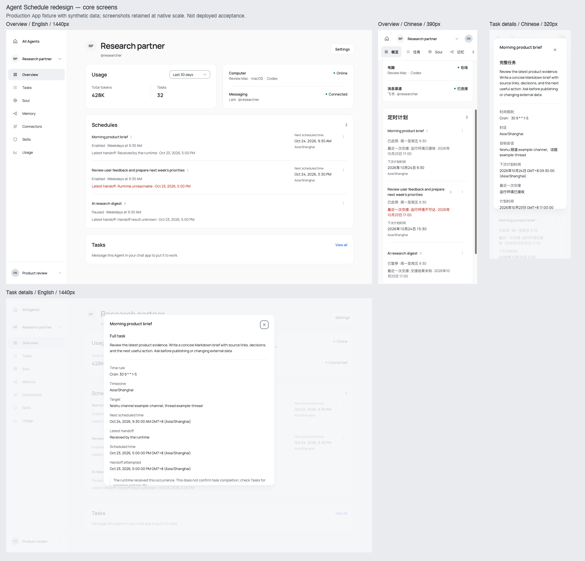
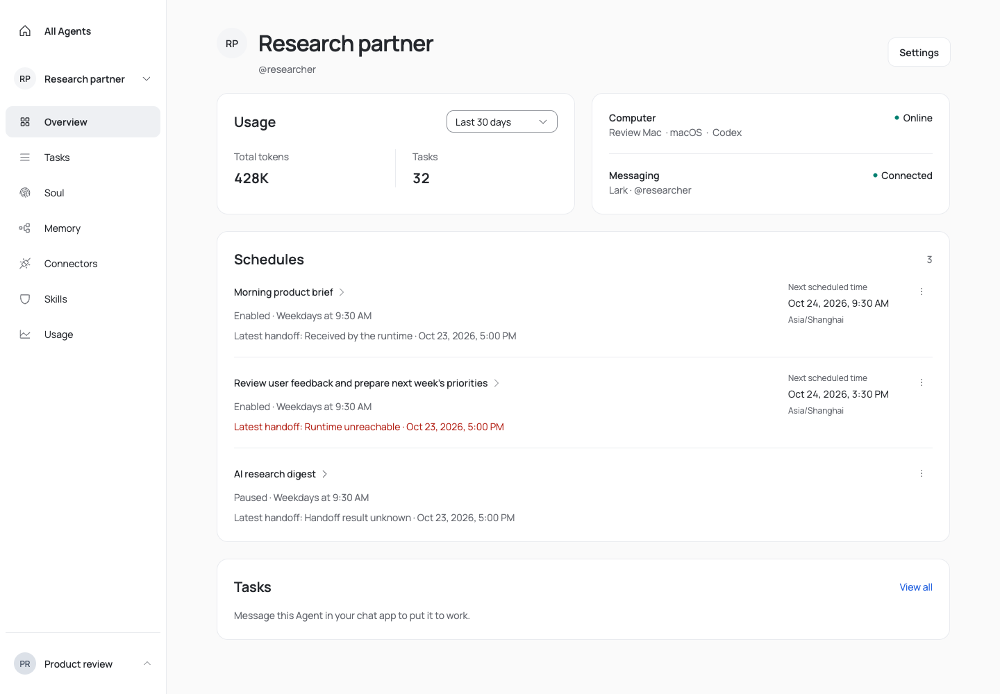
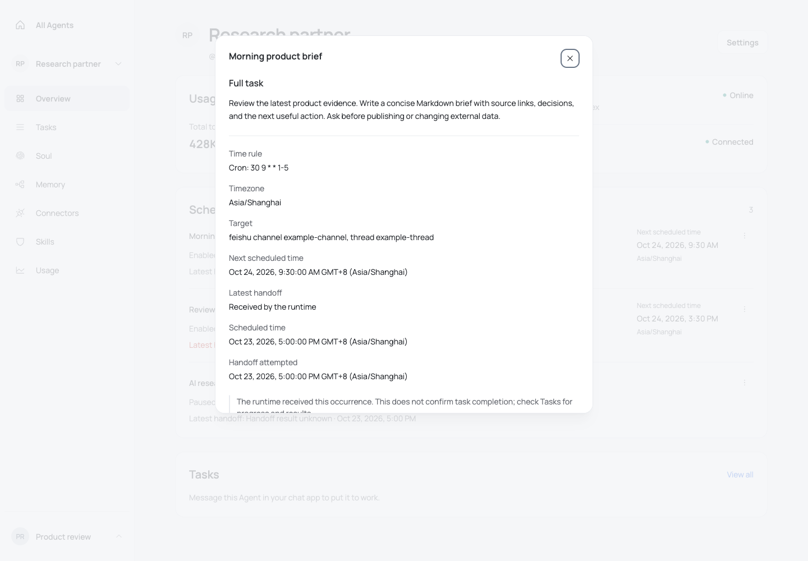

# Agent Schedule redesign and Memory review

## Scope and result

Schedules now use compact divided rows inside the existing Overview card. Names open a focused task dialog;
pause/resume and delete live in the row action menu. The list retains configuration state, next trigger,
timezone, and the latest handoff outcome/time. Common daily, weekday, weekly and interval rules have localized
summaries; complex cron expressions stay literal, and details preserve every original cron expression.
Short timestamps retain the year and expose their complete timezone-aware value to assistive technology.

Busy actions prevent overlapping writes. A refused deletion keeps its error in the confirmation dialog,
Cancel is initially focused, and a confirmed deletion returns focus to the section after the source row is
removed. Switching Agents closes private details. Failed refreshes keep loaded rows and offer retry.
Summary paging, observed revision checks, the existing deep link, and lazy Account-authorized task reads remain.
An accepted handoff remains a runtime receipt, not a completed business task.

Memory is a review deliverable, not an implementation. [The review](memory-review.md) records ten findings,
their observed/code-traced evidence, a page/state proposal, acceptance criteria, and the follow-up comparison
with Soul, Skills, MCP and Settings. The preferred direction reuses the Skills/MCP resource-management frame,
the shared header action, and Soul's centered empty state and stable feedback.

## Verification boundary

- Schedule browser evidence mounts the production `App`, real router, shell, page, components, CSS and translations
  in a local Vite-built fixture. Account, Computer, Messaging, usage, task and Schedule API responses are synthetic.
  The fixture rejects unexpected JavaScript fetches. It is not a live-server or deployed product acceptance run.
- `schedule-matrix.json`: English/Chinese × 320/390/768/1440px × normal, empty, 120-character name, exhausted
  one-time schedule and paged summaries: 40 combinations, no document/frame/section overflow, no eager private
  detail reads, and no unexpected API requests. The detail dialog also fits all eight locale/width combinations.
- `schedule-flow-results.json` records the actual keyboard, action, recovery and scoped axe results.
- The current dev browser redirects to sign-in. Real GitHub authorization, schedule dispatch, runtime delivery,
  and deployed-product acceptance remain unverified. No repository, schedule, or remote configuration was created
  by the browser fixture. Stored English example names are intentionally not translated by switching UI locale.
- Memory evidence uses the real isolated settings component with synthetic API/config refreshes; its 56 combinations
  and representative flows are separately described in `memory-review.md` and its two JSON summaries.

## Local checks

- `pnpm --filter @opentag/web test src/features/agents/agent-schedules-section.test.tsx`: 29 tests passed.
  Coverage includes handoff meaning, prompt lazy loading, pagination/recovery, deep links, observed revisions,
  overlapping mutations, rejected deletion, focus recovery, Agent switches and conservative cron presentation.
- `pnpm --filter @opentag/web typecheck`: passed during development; the native pre-push gate checks all packages.
- `pnpm --filter @opentag/web build`: passed. Existing `node:crypto` browser-externalization and large-chunk warnings
  remain; the configured bundle gates pass. The local fixture build also passed.
- `pnpm check`: passed after formatting the evidence JSON. Existing repository-wide complexity warnings and the
  Biome configuration-schema version notice remain; the complexity ratchet and Context Tree verification pass.
- CI and authenticated deployed acceptance are separate requirements; local results do not assert either passed.

## Visual evidence

### Core screens after the change

The overview and task details below use the production App fixture with synthetic data.
They show the implemented branch, not a deployed acceptance run. The contact sheet preserves
the native screenshot scale; use the individual images for focused review.

#### Desktop overview — English, 1440px

#### Task details — English, 1440px

#### Mobile overview — Chinese, 390px

#### Mobile task details — Chinese, 320px

### Additional states and baseline

- `schedules-before-1440.png`: original isolated component baseline.
- `schedules-after-{en,zh}-{390,1440}-normal.png`: final production shell and Schedule composition.
- `schedules-detail-en-1440.png`, `schedules-detail-zh-320.png`: focused detail dialog.
- `schedules-after-en-1440-empty.png`: composed empty state.
- `schedules-delete-error-en-1440.png`, `schedules-load-error-en-1440.png`: recovery surfaces.
- `memory-before-*.png` and `memory-review-*.png`: evidence referenced by the Memory review.

The original before image and final shell image have different surrounding contexts; compare the Schedule
composition, not the entire page height as a measured improvement. Intermediate draft images are retained
locally and excluded from the review commit.
